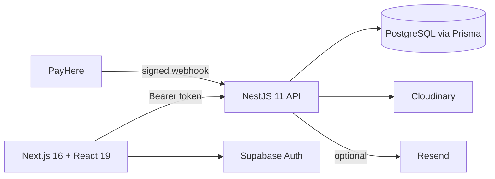

# RentalHub Sri Lanka

A rental marketplace for Sri Lanka with two ways to rent:

- **Homes**, introduced personally. A renter posts a private request and the team matches them with reviewed listings.
- **Items** (vehicles, tools and equipment, event gear), booked by date and paid online. Dates can't be double-booked, payments are verified, and cancellations follow a refund policy.

The interface is in **English, Sinhala and Tamil**.

> Built as a full-stack project with the aim of being runnable for real, not just demonstrable. [ARCHITECTURE.md](docs/ARCHITECTURE.md) explains the decisions and their trade-offs; [DEPLOYMENT.md](docs/DEPLOYMENT.md) covers going live.

## What it does

**For renters**
- Browse homes and item categories with filters; see exactly what a booking costs (rental, service fee, refundable deposit) before paying.
- Book items for chosen dates and pay through PayHere. The owner's phone number is revealed only once the booking is paid.
- Cancel with the refund shown up front. Get email and in-site alerts when something changes.
- Homes: submit a private request; the team recommends matches.

**For owners**
- List a home, vehicle, piece of equipment or event gear; edit it later; take dates off the calendar.
- Price, deposit and phone changes apply instantly. Changes to what renters read or see go back for review, so approval can't be bypassed.
- See paid bookings with the renter's number and a WhatsApp link; cancel one (the renter is refunded in full) with a reason.

**For the team**
- Review, approve, reject, deactivate or delete listings across all statuses.
- Overview counts, a refund queue ("I have sent this refund"), booking management, complaints, matching for homes, and per-admin permissions.

## How it's built



| | |
| --- | --- |
| Web | Next.js 16 (App Router), React 19, TypeScript, Tailwind 4, Playwright |
| API | NestJS 11, TypeScript, class-validator, helmet, OpenAPI at `/docs` |
| Data | PostgreSQL (Supabase), Prisma 5.22, 14 migrations |
| Auth | Supabase Auth, permissions enforced server-side |
| Payments | PayHere checkout with a signed, idempotent webhook |
| Infra | Docker images and a compose file, GitHub Actions CI |

It is a **modular monolith** on purpose. The central guarantee, that two renters never hold the same dates, is one database transaction, and splitting it across services would trade that simplicity for distributed-transaction machinery with no benefit at this scale. The modules have clear seams, and the first one I would extract (notifications) is identified in [ARCHITECTURE.md](docs/ARCHITECTURE.md).

### Things worth reading in the code

- `apps/api/src/modules/categories/category-registry.ts`: one definition per category drives validation, `GET /categories`, and the web forms and filters. New categories are mostly configuration.
- `apps/api/src/modules/bookings/`: date locking, price quotes, the PayHere webhook (signature, amount check, idempotency, late-payment handling), the cancellation policy and refund tracking.
- `apps/api/src/modules/notifications/`: alerts that never break the operation that caused them.
- `apps/web/components/booking-panel.tsx`: live price from the API, so the page can't show a different amount than the booking charges.
- `packages/db/prisma/migrations/`: every schema change, applied to an empty database in CI. The recent ones only add tables, columns and values, or relax constraints, so older code keeps working against a newer database.

## Run it

### With Docker (needs a free Supabase project for sign-in)

```bash
cp .env.docker.example .env.docker        # add your Supabase URL and publishable key
docker compose --env-file .env.docker up --build
```

Website <http://localhost:3000> · API <http://localhost:3001> · API docs <http://localhost:3001/docs>. The API creates the database tables on start. Payments and email stay off until their keys are added.

### Without Docker

```bash
pnpm install
cp apps/api/.env.example apps/api/.env          # database, Supabase, Cloudinary
cp apps/web/.env.example apps/web/.env.local
pnpm db:generate
pnpm --filter db exec prisma migrate deploy
pnpm dev:api        # http://localhost:3001
pnpm dev:web        # http://localhost:3000
```

Stop the API before running `pnpm db:generate` on Windows, otherwise the database engine file is locked.

### Sample data

```bash
cd apps/api && node --env-file=.env scripts/seed-demo.cjs --yes
```

Adds eight sample vehicles, tools and event-gear listings under one fake owner, and `--remove --yes` takes them out again. It prints the database it will write to and refuses to run without `--yes`.

## Checks

`pnpm verify` runs everything CI runs: type-check, lint, all tests and a production build.

| Suite | Count | What it covers |
| --- | --- | --- |
| API unit | 189 | Pricing, dates, refund policy, category validation, PayHere signing and webhook edge cases, edits, blocked dates, alerts, seed data |
| API HTTP | 126 | Real guards, validation and routes against an in-memory database |
| Web unit | 63 | Sign-in redirects, translations (all three languages must cover every text), helpers |
| Browser (Playwright) | 46 | Booking and payment hand-off, cancellation, owner edits, photos and calendar, admin refunds, sign-in, landing page, plus automated accessibility scans (axe) of 17 page and mode combinations in light and dark |

CI also applies every migration to an empty Postgres and fails if the result differs from `schema.prisma`, and builds both Docker images. `pnpm audit --prod` reports no known vulnerabilities; the few remaining moderate findings are inside build tools (Nest CLI, ESLint) and do not ship.

Browser tests run against a mocked backend, and the Docker files are verified by CI, not by hand. PayHere's real sandbox has not been exercised yet; [DEPLOYMENT.md](docs/DEPLOYMENT.md) lists the steps before going live.

## Documentation

| | |
| --- | --- |
| [docs/ARCHITECTURE.md](docs/ARCHITECTURE.md) | Design decisions, data model, security, known limitations |
| [docs/DEPLOYMENT.md](docs/DEPLOYMENT.md) | Hosting, settings, going live with payments, backups |
| [docs/OPERATIONS.md](docs/OPERATIONS.md) | Original homes pilot: API contract, upload rules, configuration |
| [docs/LAUNCH-READINESS.md](docs/LAUNCH-READINESS.md) | Business, trust and support decisions before accepting real users |
| `/docs` on the API | Interactive OpenAPI reference |

## Status and limitations

The product includes paid booking ratings and an owner verification request/review workflow. Ratings are numeric and tied to completed paid bookings; owner verification is a staff-recorded manual check, with no identity documents collected by the app. Refunds, deposits and owner transfers still require manual operations. The PayHere sandbox has not yet been exercised, rate limiting is per API process, and Sinhala and Tamil text needs native-speaker review. See [ARCHITECTURE.md](docs/ARCHITECTURE.md#known-limitations) and [LAUNCH-READINESS.md](docs/LAUNCH-READINESS.md) for remaining limits and decisions.

No open-source licence has been chosen yet, so all rights are reserved by default.
