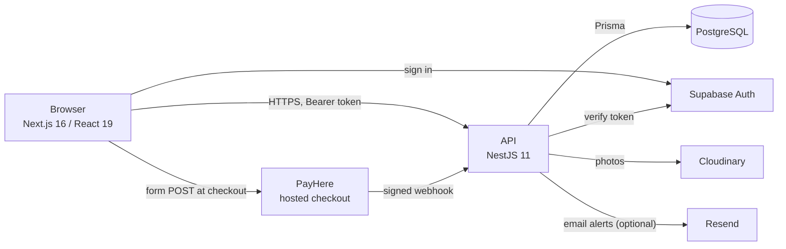
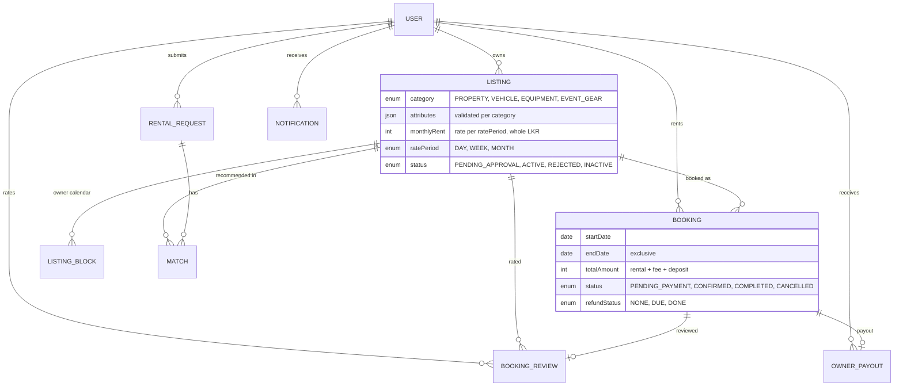

# Architecture

RentalHub Sri Lanka is a rental marketplace with two ways to rent:

- **Homes** are introduced personally: a renter posts a private request and the team matches them with listings.
- **Items** (vehicles, tools and equipment, event gear) are booked by date and paid for online. There is no admin in the middle.

This document explains how it is built and, more usefully, why.

## System overview

The web app never talks to the database. The API is the only writer and the only place rules are enforced; the browser is treated as untrusted.

## One deployable, many modules

The API is a **modular monolith**: one process and one database, divided into NestJS modules with narrow public surfaces.

| Module | Responsibility |
| --- | --- |
| `listings` | Create, browse, moderate and edit listings; owner calendar (blocked dates) |
| `categories` | The category registry: fields, rate periods and validation per category |
| `bookings` | Quotes, date locking, PayHere checkout and webhook, cancellations, refunds |
| `requests` + `matching` | Home requests and the admin matching workflow (homes only) |
| `notifications` | In-site notifications and optional email (`NotifyService`, `MailerService`) |
| `admin` | Permissions and the overview counts |
| `users`, `complaints`, `cloudinary` | Accounts, reports, photo upload |

Shared code lives in `common/` (guards, pagination, geography, the Prisma service). The web app is in `apps/web`, the schema and migrations in `packages/db`.

## Decisions

### 1. A modular monolith, not microservices

**Decision:** keep one API and one database.

**Why.** The most important rule in the system, *two renters can never hold the same dates*, is a single database transaction. Splitting bookings from listings would turn that into a distributed transaction (sagas, an outbox, compensation logic) to solve a scaling problem that does not exist. Microservices also multiply the things a small team has to run: pipelines, deployments, monitoring, versioned contracts between services.

**What keeps the option open.** Modules talk through services, not through each other's tables. `NotifyService` is already the only way anything sends a notification, so extracting notifications into a queue-fed worker would change one class, not every caller.

**When I would split.** Notifications and email first: they are asynchronous and retryable, and need to scale differently from request/response traffic. After that, the payment webhook, if its traffic or risk profile ever justified isolation. A second team or a measured bottleneck would be the trigger, not fashion.

### 2. A category registry in code, with validated JSON for category fields

Each rentable category (vehicle, equipment, event gear) has different fields. Options considered:

| Option | Why not |
| --- | --- |
| A table per category | Triples browse, admin, moderation and search code |
| Admin-editable schemas in the database | Over-engineered; validation logic still needs code |
| **One `listings` table, category fields as JSON validated against a registry** | **Chosen** |

`category-registry.ts` defines each category's fields, allowed rate periods and rules. `GET /categories` serves it, and the web draws forms and filters from it, so adding a category is a registry entry plus text rather than new endpoints and pages. Homes keep their own columns; they are not forced into JSON.

Unknown keys, wrong types and out-of-range values are rejected, so only known fields are ever stored or published.

### 3. Preventing double booking

Bookings use half-open date ranges (`start` up to, not including, `end`), so back-to-back rentals do not clash. Creating a booking runs in one transaction that first locks the listing row (`SELECT … FOR UPDATE`), then checks for overlapping paid bookings, unpaid bookings still inside their 30-minute payment window, and owner-blocked dates, and only then inserts.

A database exclusion constraint was considered and rejected: an unpaid hold expires with the clock, and constraints cannot depend on `now()`. The same lock is taken by the payment webhook and by "block dates", so all three paths are serialised per listing. Tests cover the clash paths.

### 4. Trusting a payment notification

PayHere calls a public webhook, so the request is treated as hostile until proven otherwise:

1. The MD5 signature must match the merchant secret.
2. The amount and currency must equal what we charged, not what the request claims.
3. Handling is idempotent: a repeat notification does nothing.
4. A payment that arrives after the dates were taken cannot be honoured. The booking is recorded as cancelled with the full refund owed, and the renter is told.

The checkout form is signed by the API, so changing the amount in the browser fails at PayHere.

### 5. Privacy as a feature

Owner and renter phone numbers are never public. For homes, the team introduces people. For items, each side sees the other's number only **after the booking is paid**, which is also what protects the platform's fee. Public location is rounded to a grid; exact coordinates are available to the listing owner and authorized staff, not public visitors.

### 6. Editing cannot bypass moderation

Owners can change price, deposit and phone number instantly. Anything renters read or see (title, description, photos, area, details) sends a live listing back for review. An admin-deactivated listing stays deactivated no matter what the owner edits. Existing bookings keep the price they were made at.

### 7. Refunds are recorded, not automated, for now

When a booking is cancelled, the cancellation policy computes the refund and stores it as *owed*. A team member sends it from the PayHere dashboard and marks it done, which emails the renter. This is deliberate for a first version: refund volume is tiny, and a reconciled manual process is safer than an automated one that was never exercised against a live account. Automating it is the obvious next step.

The policy is configuration (`CANCEL_*` settings) and is mirrored in the Terms page. The two must be kept in sync.

### 8. Notifications never break the thing that caused them

`NotifyService` records an in-site notification and, if an email provider is configured, sends an email without making the caller wait. It never throws. A failed email must not undo a booking or an approval, and PayHere's webhook must answer quickly.

## Data model

Money is stored as whole Sri Lankan rupees (integers), never floats. Migrations are checked in CI by applying all of them to an empty database and diffing the result against `schema.prisma`. The recent ones only add tables, columns and enum values or relax constraints, which is what makes rolling back code safe.

## Security

- Supabase issues tokens; the API verifies every protected request and checks permissions server-side.
- Request bodies are whitelisted and validated; unknown fields are rejected, so a client cannot set `ownerId`, `role` or `status`.
- `helmet`, a strict CORS allow-list (one frontend origin), and a Content-Security-Policy on the web app. The one allowed cross-site form post is PayHere's checkout.
- Uploads are checked by their real file contents and stripped of metadata such as GPS location.
- Write routes are rate limited.
- Public listing responses use an explicit serializer, so adding a database column never publishes it by accident.

## Known limitations

Stated plainly, because they are the roadmap:

- Rate limiting counts in memory, so it is per process. Several API instances need shared storage first.
- Refunds, deposit returns and owner transfers are performed manually. The admin payout ledger records amounts due and transfers recorded, but it does not move money or track deposit custody separately.
- PayHere sandbox and live merchant flows have not been exercised; payment setup and real transactions remain launch work.
- Ratings are numeric only, one per completed paid booking. There are no written reviews or review moderation workflow.
- Owner verification records a request and a staff decision after a manual check outside the app. The app collects no identity documents and does not define the evidence or checking procedure.
- Event gear is booked as a single unit; its `quantity` field is informational and is not used to reserve multiple units.
- Sinhala and Tamil text needs a native speaker's review.
- No load testing has been done.
