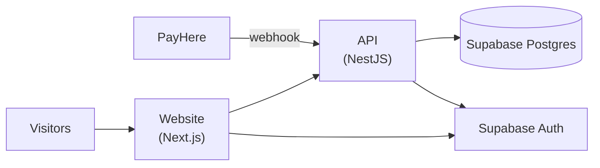

# Deployment guide

How to take RentalHub from a laptop to a public site. It assumes one of each: a Supabase project, a host for the API, and a host for the website. Any hosts that run Node or Docker work; the steps below name common choices only as examples.



## 1. Before you start

- A [Supabase](https://supabase.com) project (database and sign-in).
- A [Cloudinary](https://cloudinary.com) account for photos.
- Optional now, needed for full function: a [PayHere](https://www.payhere.lk) merchant account, and a [Resend](https://resend.com) account with a verified sending domain.
- A domain name (strongly recommended, and required by payment providers for live mode).

## 2. Database and sign-in (Supabase)

1. Create the project and copy the **pooled** connection string (port 6543) for `DATABASE_URL` and the **session** connection string (port 5432) for `DIRECT_URL`. URL-encode special characters in the password.
2. Authentication → Providers: enable **Email**. Decide whether to require email confirmation.
3. Authentication → URL configuration: set the site URL to your website origin, and add `https://your-site/reset-password` as a redirect URL (password recovery uses it).
4. Apply the schema: from the repository root, with `DATABASE_URL` and `DIRECT_URL` set,

   ```bash
   pnpm --filter db exec prisma migrate deploy
   ```

   The API image runs this on every start, so this step is only needed if you deploy without Docker. It only applies migrations that have not run yet.
5. Create the first administrator: sign up through the website, then in the Supabase SQL editor insert a row into `admin_permissions` for that user with the permission flags you want (see [OPERATIONS.md](OPERATIONS.md), *Verification*).

## 3. The API

Build it from the Dockerfile (`apps/api/Dockerfile`, build context = repository root) or run `pnpm --filter api build` then `node apps/api/dist/main.js`.

| Variable | Required | Notes |
| --- | --- | --- |
| `DATABASE_URL`, `DIRECT_URL` | yes | From Supabase |
| `SUPABASE_URL`, `SUPABASE_PUBLISHABLE_KEY` | yes | Token verification |
| `FRONTEND_URL` | yes in production | The exact website origin, e.g. `https://rentals.example.lk`. One origin only, no path, no wildcard. The API refuses to start without it. |
| `API_PUBLIC_URL` | for payments | The API's public address. PayHere calls `${API_PUBLIC_URL}/payments/payhere/notify`, so it must be reachable from the internet. |
| `CLOUDINARY_CLOUD_NAME`, `_API_KEY`, `_API_SECRET` | for photos | |
| `PAYHERE_MERCHANT_ID`, `PAYHERE_MERCHANT_SECRET` | for payments | Sandbox values first |
| `PAYHERE_SANDBOX` | | `true` until you go live, then `false` |
| `RESEND_API_KEY`, `EMAIL_FROM` | for email | Without them alerts stay in the site |
| `BOOKING_SERVICE_FEE_PERCENT` | | Default 10 |
| `CANCEL_FULL_REFUND_DAYS`, `CANCEL_PARTIAL_REFUND_DAYS`, `CANCEL_PARTIAL_REFUND_PERCENT` | | Defaults 7 / 2 / 50. Keep the Terms page in step with these. |
| `ENABLED_CATEGORIES` | | Comma-separated, e.g. `PROPERTY,VEHICLE`, to open categories one at a time |
| `ENABLE_API_DOCS` | | `true` publishes `/docs`; off by default in production |
| `TRUSTED_PROXY_CIDRS` | behind a proxy | Only the proxy's exact addresses. Never a catch-all range. |
| `SUPABASE_SERVICE_ROLE_KEY` | required for account deletion | Lets "delete my account" also remove the sign-in identity. Server-side only; without it, a deleted account's old login may still authenticate. |

Point your host's health check at `GET /health/ready`: it returns 503 when the database is unreachable.

The API and website Docker runtime stages run as the unprivileged `node` user and install production dependencies only.

**Run one API instance at first.** Rate limiting counts in memory, so several instances multiply the limits (see ARCHITECTURE.md, *Known limitations*). Configure shared throttler storage before scaling the API horizontally.

## 4. The website

Build from `apps/web/Dockerfile`, or `pnpm --filter web build` and `pnpm --filter web start`. The `NEXT_PUBLIC_*` values are baked into the browser bundle at build time:

| Variable | Notes |
| --- | --- |
| `NEXT_PUBLIC_API_URL` | The API's public address |
| `NEXT_PUBLIC_SITE_URL` | The website's own origin (sitemap, canonical links) |
| `NEXT_PUBLIC_SUPABASE_URL`, `NEXT_PUBLIC_SUPABASE_PUBLISHABLE_KEY` | Sign-in |
| `NEXT_PUBLIC_CONTACT_EMAIL` | **Required before launch.** A monitored support address shown on help and legal pages; the example value is a placeholder. |

The same values must be present when the server starts, because the Content-Security-Policy is built from them.

## 5. Going live with payments

Do these in order, and do not skip the sandbox pass.

1. In sandbox, with a public tunnel or a deployed API as `API_PUBLIC_URL`, make a real booking and pay it with a PayHere sandbox card. Confirm: the booking becomes **Confirmed**, the owner's number appears for the renter, both people get an alert, and the admin Bookings page shows it paid.
2. Cancel that booking as the renter and confirm the refund shown matches the policy. Mark the refund sent from the admin page and check the renter is told.
3. Complete PayHere's merchant verification for live mode and register your website domain in their dashboard, following their current instructions.
4. Set the live merchant ID and secret, set `PAYHERE_SANDBOX=false`, redeploy the API, and make one small real booking and refund yourself.
5. Update the Terms page if you changed any `CANCEL_*` value or the service fee.

Before the first real booking, settle the owner payout, deposit custody and dispute, and support-response policies in [LAUNCH-READINESS.md](LAUNCH-READINESS.md). The current payout and refund work is manual.

## 6. After deploying

**Smoke test** (about ten minutes): open the home page; browse a category; sign up and confirm the email; list an item as one account; approve it as an admin; book it with another account; check the alerts; cancel; check `/health/ready`.

**Backups.** Use Supabase's backups (point-in-time recovery on paid plans) and practise a restore once before you need one.

**Monitoring.** Uptime check on `/health/ready`. In production the API logs one JSON object per line with a request id, which any log platform can index. Adding an error tracker such as Sentry is a sensible first addition.

**Rolling back.** The recent migrations only add tables, columns and values, or relax constraints. To roll back code, redeploy the previous image; the newer columns are simply unused. Do not delete columns by hand, and write future migrations the same way: add first, remove only after no running version needs it.

## 7. Running everything locally with Docker

```bash
cp .env.docker.example .env.docker      # add your Supabase URL and publishable key
docker compose --env-file .env.docker up --build
```

This starts a local Postgres, the API (which applies all migrations) and the website: <http://localhost:3000>, API docs at <http://localhost:3001/docs>. Sign-in still uses your Supabase project. Payments and email stay off until their keys are added. To fill the empty database with sample vehicles, equipment and event gear, run the seed script (it asks for `--yes` and prints which database it will write to):

```bash
cd apps/api && node --env-file=.env scripts/seed-demo.cjs --yes
```
